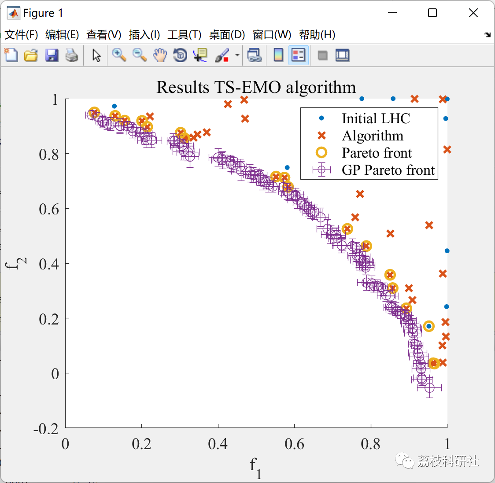

# [New Multi-Objective Optimization Algorithm] Thompson Sampling Efficient Multi-Objective Optimization (TSEMO) Algorithm (Matlab Code Implementation)

💥💥💥💞💞💞💞 Welcome to this blog❤️❤️❤️💥💥💥
🏆 Bloggers' Advantage: 🌞🌞🌞 The content of the blog strives to be rigorous in thought and clear in logic, for the convenience of readers.
⛳️ Mantra: The journey of a hundred miles is half done in the last ninety.
Litchi Research Society
Code Collection: Power System, Intelligent Algorithms and Applications, Neural Network Prediction, Path Planning, Optimized Scheduling, Workshop Scheduling, Image Processing, Signal Processing...
🎁Column Directory Link:
🌈🌈🌈🌟🌟🌟Electrical Code Intelligent Algorithm and Its Application Path Planning Neural Network Predictive Optimization Scheduling Image Processing Workshop Scheduling Signal Processing Romantic Her My Philosophical Thoughts Math Modeling Complete Code Matters
💥1 Overview
📚2 Running Results
🎉3 References
🌈4 Matlab code implementation
💥1 Overview
This algorithm aims to perform global multi-objective optimization on black-box functions with high evaluation costs. For example, it has been applied to simultaneously optimize the cost of Life Cycle Assessment (LCA) and chemical process simulations [2]. However, this algorithm can also be applied to other black-box functions, such as CFD simulations. It is based on Bayesian optimization methods, which construct Gaussian process agent models to accelerate optimization. Additionally, the algorithm can identify several promising points in each iteration (batch order pattern). This allows for parallel assessment of multiple simulations.
📚2 Running Results
🎉3 References
[1] Bradford,  E.,  Schweidtmann,  A.M. & Lapkin,  A. J Glob Optim (2018).https://doi.org/10.1007/s10898-018-0609-2  
[2] D. Helmdach, P. Yaseneva, P. K. Heer, A. M. Schweidtmann, A. A. Lapkin. ChemSusChem 2017, 10, 3632. https://doi.org/10.1002/cssc.201700927
🌈4 Matlab Code Implementation
Click the left bottom corner of the article to read in full.

## Images

<!-- PAYMENT_BLOCK -->

## Get this dataset

- Payment link (Stripe): [Buy now](https://buy.stripe.com/3cs8yP7sY87d0vu9AB)
- Payment QR code: 

<!-- /PAYMENT_BLOCK -->
